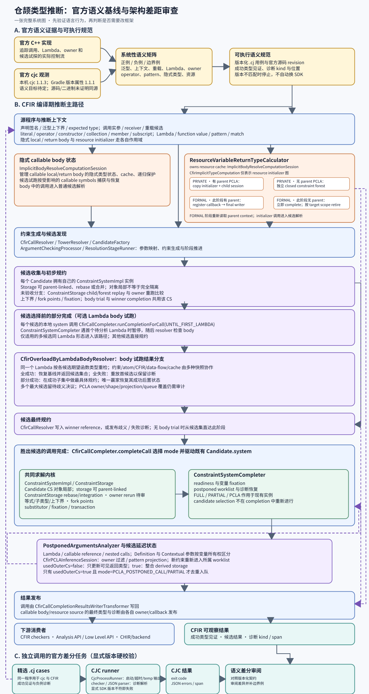

# 仓颉类型推断官方语义基线与 CFIR 架构差距审查计划

> 状态：本方案尚未实施；当前工作树已有相关源码改动，审查基线见 §0.1
> 语义依据：仓颉官方 C++ 源码与独立记录版本的 `cjc` 观测（源码/二进制对应关系须单独确认）
> 当前判断：证据不足以确认整体框架重设计必要；当前工作树中的 parent/child lineage/replay 是未验收的窄内核扩展候选，需与 owner 重算比较，不预设采纳或替换

## 0. 方案回答的问题

**直接回答：需要做有边界的框架重构，重点是候选/会话状态所有权、失败试跑回滚及 parent-child storage 生命周期；不需要把整个类型推断系统或共同求解器推倒重写。**目前每个 candidate 有自己的 CS，但 Lambda 试跑还要恢复 candidate、postponed atom、CFIR、implicit-body cache、resource retained graph 与 data-flow/CFG；PCLA session 另持有 semi-fixed 变量、owner/shape、projection 和队列水位。重构必须把这些状态在哪一层创建、试跑期间能否变更、失败如何撤销、赢家如何提交讲清楚。

当前工作树里的 `ConstraintSystemBaseline`/mutation journal/rebase/inference-forest 是一条可能的窄实现路线，**尚不能认定它就是正确方案**。需要与丢弃 child storage、在最新 owner 上重跑同一推断的路径比较，并运行对应内部测试。官方 C++ 的候选试探、Lambda 局部变量域和胜出候选重查支持这种局部事务/作用域分层；它没有要求一个全局 solver，也没有规定 CFIR 必须照搬当前这套 lineage/replay 存储设计。

**这份框架级方案是合适的审查路线，但不是直接批准当前 lineage patch 的实施规格。**当前 CJC 一致性入口未启用，已有官方证据分散，成功推断的类型见证也没有稳定入口；因此先复用已有材料、补最小区分用例，再决定保留或重做哪段状态协议。它不要求从零建立全语言笛卡尔积测试集。仓库 `cangjieVersion` 是 Gradle 项目版本属性，不能单独决定官方语义基线。

这与指定会话中的结论一致：仓颉应由自己的语言语义决定推断策略；不能因为 Kotlin FIR 有 PCLA 就照搬，也不能把所有类型变量放入全程序约束图。官方 C++ 显示，普通泛型调用、Lambda 自有参数和重载候选各有局部算法；同时，受限场景下 Lambda body 的约束确实能参与外层泛型和重载决策。因此 PCLA 类能力不能先验删除，也不能先验推广为新的全局求解内核。

本方案分成三个有决策门的部分：

1. **官方行为取证**：从官方 C++ 实现定位语义路径，并用版本明确的 `cjc` 观测最小用例；若二进制与源码的版本关系无法核实，就把它们作为独立证据记录，记录成功、失败、诊断和可观察的推断结果。
2. **可执行语义规范**：把用例、预期行为、编译器版本和验证方法固化为持续运行的测试契约，而不是仅保存在分析文档中。
3. **架构差距审查**：先复用现有 `ConstraintSystemImpl`、`CfirCallCompleter` 和 `ConstraintSystemCompleter`；发现可复现的框架缺口后再定向重设计，只有证明共同内核无法表达某项行为时才提出内核扩展。

### 0.1 当前审查基线（执行前重新冻结）

- 当前检出的仓库 HEAD 为 `a6b673ccda1cf17517626ccf61361524dc9e2b4b`。
- 当前暂存区和工作树都包含尚未提交的推断相关改动，涉及 `ConstraintSystemImpl`、`Candidate`/`CandidateFactory`/`CandidateTraversal`、`CfirCallCompleter`、completion writer、implicit computation、inference/PCLA session、`ConstraintSystemCompleter`、`CfirDeserializedSymbolProvider`/`CfirDefaultSessionFactory`，以及父子约束重基、完成边界、快照、CFG 采用/回滚等测试。这些改动不是本方案的产物，也不能仅因测试文件存在就视为验证通过。
- 冻结时记录 HEAD hash、staged/unstaged binary diff 内容、相关未跟踪源码/测试清单及各文件 SHA-256，并单独记录本方案文件 hash；hash 只用于核验，必须同时保留可重放 patch 或不可变 worktree，确保快照能重建。不同快照使用隔离 worktree/build 输出，避免测试产物串扰。
- 后续测试和判断必须区分这三个快照。当前工作树测试只说明“该工作树整体”的行为；若结论依赖某项 index/worktree 改动，至少在相应基线和当前快照上比较，不得把未提交实现当成已确证的现状。
- 官方证据并非从零开始：[`diagnostics2/README.md`](../cfir/analysis-tests/testData/diagnostics2/README.md) 已记录 cjc 1.0.5/1.1.3 的多版本诊断取证，`cfir/analysis-tests/REPAIR_LOG.md` 也积累了大量类型推断与官方编译器对照。本方案先索引、复用并标记这些证据的版本和工作树归属。
- 当前可执行 `cjc` 有 1.0.5 和 1.1.3 两个版本；仓库 `cangjieVersion=1.1.1` 不代表这两个版本中的任何一个，也不能据此推断规范目标。开始实现自动化前必须按项目实际支持的语言/SDK 版本确定 oracle 目标。
- 官方源码镜像有 `v1.1.1` (`dafb3074984558f568c8804b74a5161e327243a2`) 与 `v1.1.3` (`14276740ffec1262b81b6b5236b1d840af270b37`) 标签；`v1.1.1..v1.1.3` 在六个核心推断文件中有 4 行新增、1 行删除，但当前 `main` 相对 `v1.1.3` 在这六个文件中有 3248 行新增、1171 行删除。当前 checkout 的 HEAD `d755a444...` 不能不加区分地代表发布版语义；具体源代码结论必须标明采用的 tag/HEAD。

## 1. 当前实现与问题

### 1.1 当前已有的基础

- `resolution.common` 已有 `ConstraintSystemImpl`、约束存储、变量固定、substitutor、事务、派生/合并状态和 fork-point 处理；CFIR 每个调用候选拥有自己的约束系统。
- 当前暂存区和工作树还在 `ConstraintSystemImpl` 上增加 `ConstraintSystemBaseline`/snapshot、mutation journal、`synchronizeWithOwner`、`rebaseToOwner`、derived-storage 与 constraint-storage forest integration。它是一个待验证的 parent/child lineage 协议，不是已确认的 solver 必要能力；必须和在 actual owner 上重算 child inference 的方案比较。
- `CfirCallCompleter` 已选择 FULL/PARTIAL/PCLA 等完成模式；`ConstraintSystemCompleter` 已有固定变量、分析 postponed arguments、PCLA 尝试和恢复循环。不要再新建并行 completion coordinator。
- `cfir:resolve` 已有 `CfirInferenceSession`、`CfirPCLAInferenceSession`、候选试跑快照、postponed atom、Lambda body 分析和隐式 initializer 图。
- `cfir/analysis-tests/testData/llt/type_infer` 有一批类型推断用例，生成的 LLT 测试会验证 CFIR 对这些用例的处理。
- `CjcProcessRunner` 与 `CfirCjcLlTDiagnosticsChecker` 已能调用官方 `cjc` 并比较诊断。runner 当前按 `CANGJIE_HOME`、系统属性 `cjc.home`、用户 SDK 目录的顺序查找 `cjc.exe`；诊断 checker 只比较 ERROR 诊断。

对应实现入口包括 [`ConstraintSystemImpl.kt`](../resolution.common/src/org/cangnova/cangjie/resolve/calls/inference/model/ConstraintSystemImpl.kt)、[`CfirCallCompleter.kt`](../cfir/resolve/src/org/cangnova/cangjie/cfir/resolve/inference/CfirCallCompleter.kt)、[`ConstraintSystemCompleter.kt`](../cfir/resolve/src/org/cangnova/cangjie/cfir/resolve/inference/ConstraintSystemCompleter.kt)、[`CfirInferenceSession.kt`](../cfir/resolve/src/org/cangnova/cangjie/cfir/resolve/inference/CfirInferenceSession.kt)、[`CfirPCLAInferenceSession.kt`](../cfir/resolve/src/org/cangnova/cangjie/cfir/resolve/inference/CfirPCLAInferenceSession.kt)、[`CfirOverloadByLambdaBodyResolver.kt`](../cfir/resolve/src/org/cangnova/cangjie/cfir/resolve/calls/overloads/CfirOverloadByLambdaBodyResolver.kt)、[`CfirImplicitTypeComputation.kt`](../cfir/resolve/src/org/cangnova/cangjie/cfir/resolve/inference/CfirImplicitTypeComputation.kt)、[`CjcProcessRunner.kt`](../cfir/analysis-tests/testFixtures/org/cangnova/cangjie/cfir/analysis/tests/golden/CjcProcessRunner.kt) 和 [`CfirCjcLlTDiagnosticsChecker.kt`](../cfir/analysis-tests/testFixtures/org/cangnova/cangjie/cfir/analysis/tests/services/CfirCjcLlTDiagnosticsChecker.kt)。

边界要分清：`CfirImplicitTypeComputation` 是围绕 `CfirResourceVariable` 的 resource initializer 图；`ImplicitBodyResolveComputationSession` 管理 callable body 的隐式类型计算状态/缓存。不能把 local、return 和 resource 说成共用一张 initializer 图。

PCLA 具体类型分支还出现在 [`CfirCallResolver.kt`](../cfir/resolve/src/org/cangnova/cangjie/cfir/resolve/body/CfirCallResolver.kt)、[`CandidateFactory.kt`](../cfir/resolve/src/org/cangnova/cangjie/cfir/resolve/calls/candidate/CandidateFactory.kt)、[`CfirExpressionsResolveTransformer.kt`](../cfir/resolve/src/org/cangnova/cangjie/cfir/resolve/body/CfirExpressionsResolveTransformer.kt)、[`CfirPatternBindingResolution.kt`](../cfir/resolve/src/org/cangnova/cangjie/cfir/resolve/body/CfirPatternBindingResolution.kt)、[`ResourceVariableReturnTypeCalculator.kt`](../cfir/resolve/src/org/cangnova/cangjie/cfir/resolve/body/ResourceVariableReturnTypeCalculator.kt) 和 [`BodyResolveContext.kt`](../cfir/resolve/src/org/cangnova/cangjie/cfir/resolve/transformers/body/resolve/BodyResolveContext.kt)。这说明要审查的是 PCLA 策略能力如何跨语义层交接，不是推断核心不存在。

### 1.2 需要解决的问题

| 现状 | 影响 | 本方案的处理 |
| --- | --- | --- |
| 当前 LLT 生成测试主要验证 CFIR 自身结果；全量 CJC LLT 一致性入口 `CjcLlTTest` 标记为 `@Disabled` | 现有通过结果不等于官方语义一致性 | 增加单独显式调用、版本硬校验的精选语义任务；不自动并入普通 `test/check` |
| CJC checker 只比较 ERROR 诊断，且不校验 `CjcCompilationResult.exitCode`；空输出被解析为零诊断；单文件调用没有超时/显式产物位置 | 若 cjc 非零退出且没有诊断输出，当前 checker 仍可能把它当作零诊断；编译产物也可能落到非临时目录 | 新任务逐例断言 exit code；对已验证版本，允许“exit 0 且无诊断”的合法空输出，其他非空输出必须可解析；设置超时、临时产物与清理；成功场景用无反馈 witness 检查结果 |
| 语义证据分散在泛型调用、候选解析、Lambda、owner、表达式、pattern、隐式返回及 resource initializer 中 | 单一 fixture 或局部行为不能代表完整语义，也不能证明 solver 必须替换 | 建立语义矩阵和官方源码映射；先验证行为，再逐条做架构差距判断 |
| PCLA 能力从 `ConstraintSystemCompleter` 延伸到 session、resolver、表达式、pattern、resource 与 synthetic Lambda；多处按 `CfirPCLAInferenceSession` 具体类型分支 | 模式策略和候选状态所有权跨文件分散，修改行为难以确认回滚/写回是否覆盖完整 | 先审计状态读写和官方差异；仅当契约确认交接不一致时，才整理 session 策略边界；复用现有 completer |
| 候选试跑组合 constraint transaction、candidate/atom 状态、CFIR 与 implicit/resource cache 快照；data-flow 通过 isolated context/CFG 采用处理，owner 集合另留在 PCLA session | 隔离机制存在但跨对象协作，需核清恢复覆盖与 child 合并；不等于缺少通用求解器 | 明确每类状态的 owner、快照/隔离机制、回滚/提交/合并点；owner sum 作为 CFIR 内部策略模型，除非证据触发边界调整 |
| `ConstraintSystemImpl` 的 fork point 是约束分支求解，不是持续收窄的重载候选或 receiver-owner 语义集合 | 两者语义不同，不能因为名称都像“候选”就塞进同一个通用 alternative group | 保留各自领域模型，共享必要的事务/快照协议；只有证明通用内核表达不足时再扩展 |
| 当前工作树新增 parent/child lineage、mutation replay 与 constraint-storage forest 集成，测试尚未验收 | 若保留 child `ConstraintStorage` 而 parent 在其后继续变化，存储需保留约束、VM、fixed binding 和 fork outcome 的来源关系；也可能由 actual owner 上重跑 child inference 避免该协议 | 对比“保留 child storage 并 rebase/replay”与“丢弃 child 结果、在 owner 上重跑同一推断”；内部单测验证 lineage 不变量，端到端语义用例和性能数据决定是否保留 |

### 1.3 官方实现提供的关键证据

这些源码用于定位行为规则，表中行号对应当前 `external/cangjie_compiler` HEAD `d755a444...`；规范的最终预期还必须由匹配版本的 `cjc` 用例确认。若规范目标是 `v1.1.1`，需回到该 tag 核对相关实现，不能把 HEAD 机制直接套用到发布版。

| 官方源码位置 | 可核对的语义职责 |
| --- | --- |
| [`TypeArgumentInference.cpp`](../external/cangjie_compiler/src/Sema/TypeArgumentInference.cpp#L435)、[`LocalTypeArgumentSynthesis.cpp`](../external/cangjie_compiler/src/Sema/LocalTypeArgumentSynthesis.cpp#L731) | 调用候选局部迭代合成：实参/形参/返回上下文约束，经依赖图和上下界求解；未足够推断时存在 Lambda body 的 last-resort 路径，不是程序级单图推断 |
| [`LambdaExpr.cpp`](../external/cangjie_compiler/src/Sema/TypeCheckExpr/LambdaExpr.cpp#L441)、[`LambdaExpr.cpp`](../external/cangjie_compiler/src/Sema/TypeCheckExpr/LambdaExpr.cpp#L557) | `TyVarScope` 内的 Lambda 参数变量；body 合成后完整求解 innermost 未解变量，成功才写回参数并重置/重合成 body |
| [`LambdaExpr.cpp`](../external/cangjie_compiler/src/Sema/TypeCheckExpr/LambdaExpr.cpp#L470) | Lambda body 合成前扫描成员调用/属性/下标和 result-constrained 使用，求同一参数可用的 owner 候选交集 |
| [`LambdaExpr.cpp`](../external/cangjie_compiler/src/Sema/TypeCheckExpr/LambdaExpr.cpp#L697) | 上下文检查路径 `ChkLamExpr` 从目标函数类型检查 Lambda 参数，将目标返回类型设为函数体上下文，清理并重查 body；这与 `SynLamExpr` 的 Lambda 自有参数推断路径需要分别对照 |
| [`TypeCheckUtil.cpp`](../external/cangjie_compiler/src/Sema/TypeCheckUtil.cpp#L1341) | `TryEnforceCandidate` / `CanDetermineCandidate` 对 owner 声明、候选签名及泛型可确定性的处理；result-constrained 覆盖筛选的回退边界需与其他过滤阶段分开建模 |
| [`NameReferenceExpr.cpp`](../external/cangjie_compiler/src/Sema/TypeCheckExpr/NameReferenceExpr.cpp#L822)、[`NameReferenceExpr.cpp`](../external/cangjie_compiler/src/Sema/TypeCheckExpr/NameReferenceExpr.cpp#L1299) | fresh receiver 的 base sum 播种和按上界过滤是不同操作；“尚未播种”不能和“播种后被过滤为空”混为同一种空集合 |
| [`TypeCheckCall.cpp`](../external/cangjie_compiler/src/Sema/TypeCheckCall.cpp) | 候选实参试跑、候选作用域状态管理与被选中实参的再分析 |

官方实现的 C++ 代码会解释**为什么**出现某个行为；`cjc` 在已记录版本下的编译结果决定规范用例的**可观察预期**。两者不一致时先调查版本、构建配置和实验条件，不以仓库当前实现替代官方结论。

同名控制路径已在官方 `v1.1.1` tag 复核：`TypeArgumentInference.cpp` 中 `PropagatePlaceholderAndSolve`/`PrepareTyArgsSynthesis` 位于 403/425 行；`LambdaExpr.cpp::TryInferFromSyntaxInfo` 位于 206 行；`NameReferenceExpr.cpp::TryInitializeBaseSum`/`FilterSumUpperbound` 位于 514/785 行；`TypeCheckCall.cpp::MatchFunctionForCall`/`CheckMatchResult` 位于 1961/2100 行；`TypeCheckUtil.cpp::TryEnforceCandidate` 位于 959 行。函数行号和部分实现随 tag 改变，因此上表引用 HEAD 行号只用于 HEAD；源码机制已核对 tag，具体可观察结果仍缺精确 1.1.1 cjc 二进制。

### 1.4 已核实的官方行为与证据等级

本工作区可用官方二进制 `cjc 1.0.5` 和 `1.1.3`，target 均为 `x86_64-w64-mingw32`。1.0.5 的路径是 `C:\Users\lin17\.cangjie\sdks\cangjie-sdk-windows-x64-1.0.5\cangjie\bin\cjc.exe`，可执行文件 SHA-256 为 `A6171914352BF4FDDE5B117FEDC7119AA5AA2C466F49BE4678F0782E1DBA0DBC`；1.1.3 的路径是 `C:\Users\lin17\.cangjie\sdks\cangjie-sdk-windows-x64-1.1.3\cangjie\bin\cjc.exe`，SHA-256 为 `DFEBED3139AFE00EE642F75322AB82D1D97651A5E9F10EBF4F6D86ABAC061257`。这些哈希只标识单个可执行文件，不代表完整 SDK 包哈希。官方源码 checkout 的 HEAD 是 `d755a444faf17d9973db4b1060f71e1c6a2400ca`（2026-11-09，GitCode `Cangjie/cangjie_compiler` 的 `main`）；没有证明这些二进制由此 HEAD 构建。

仓库 `gradle.properties` 的 `cangjieVersion=1.1.1` 在根 `build.gradle.kts` 中赋给 Gradle `allprojects.version`；这本身**不证明**官方语义基线必须是 cjc 1.1.1。当前也没有找到 cjc 1.1.1 二进制。以下 cjc 行为是官方 1.1.3 的本机观测，与源码 checkout 是分别记录的证据，不能表述为同版本实现/行为验证。

下面的正反程序是一次性探索 probe，源文件和完整原始 JSON 尚未提交到仓库；它们是方案设计证据，不是已落地的 executable-spec 条目。第一阶段需把选中的变体变成独立 `.cj` fixture，保存完整 JSON、退出码和诊断位置。

用官方 1.1.3 对两组最小正反控制程序做了受控编译：

```cangjie
func infer<T>(f: (T) -> Unit) {}
main() {
    infer({ x => x + 1 })
    return 0
}
```

每个变体使用相同命令形式编译（`CANGJIE_HOME` 指向 SDK 内含 `bin\cjc.exe` 的 `cangjie` 目录）：

```powershell
$cjc = Join-Path $env:CANGJIE_HOME 'bin/cjc.exe'
& $cjc '.\generic-body-positive.cj' --diagnostic-format json -o "$env:TEMP\generic-body-positive.exe"
```

该程序退出码为 0、ERROR 数为 0。这只说明该调用形态有足够信息通过；它没有直接暴露推断出的 `T` 的精确类型，未来规范 suite 若要断言具体 `T` 仍需另加后续类型见证。反例只把 body 改为不使用参数的 `()`：

```cangjie
func infer<T>(f: (T) -> Unit) {}
main() {
    infer({ x => () })
    return 0
}
```

反例退出码为 1，诊断为 `sema_lambdaExpr_must_have_type_annotation` 与 `sema_unable_to_infer_generic_func`。这说明至少在“未定泛型参数 + Lambda body 的运算约束”这一具体形式中，body 信息可以参与外层泛型调用的推断；不等于所有 Lambda 都支持 Kotlin Builder Inference。

重载控制用例还加入返回类型见证，以记录实际选中的候选：

```cangjie
class IntResult { func onlyIntResult() {} }
class StringResult { func onlyStringResult() {} }

func choose(f: (Int64) -> Unit): IntResult { IntResult() }
func choose(f: (String) -> Unit): StringResult { StringResult() }
main() {
    let selected = choose({ x => x + 1 })
    selected.onlyIntResult()
    return 0
}
```

待测调用先赋给未标注类型的局部变量，之后才用 `onlyIntResult()` 检查结果类型；该见证不作为调用的 expected type。cjc 退出码为 0、ERROR 数为 0。反例保留同一重载声明和后续见证，只把 initializer 改成 `choose({ x => () })`；cjc 在调用处报 `sema_ambiguous_match`（退出码 1）。这些结果支持“该调用形态下 Lambda body 会影响泛型推断和重载候选”，不外推为一般化的 Builder Inference。

精确类型 witness 的临时探针采用返回函数类型的泛型调用：

```cangjie
func infer<T>(f: (T) -> Unit): (T) -> Unit { return f }
main() {
    let action = infer({ x => x + 1 })
    action(1) // 通过；反向控制把此处替换为 action("wrong type")
    return 0
}
```

fresh receiver 的正反探针为：

```cangjie
class HasOwnerMember {
    func ownerOnly() {}
}
class OtherOwner {}
let inferred = { x => x.ownerOnly() }
main() {
    inferred(HasOwnerMember()) // 通过；反向控制替换为 inferred(OtherOwner())
    return 0
}
```

这两组都用独立正反文件分别编译 cjc 1.0.5 和 1.1.3；两版结果一致，反向控制分别报 `sema_mismatched_types`。它们的源文件已删除，当前只保留在此作为可审查的探索记录，第一阶段仍需迁成正式 fixture。

本轮又用 cjc 1.1.3 编译现有 `lambda_param_05/07/08/09.cj`：四个文件均退出 0、错误数为 0；`05` 无诊断时输出为空，`07/08/09` 输出 JSON，分别有 6/3/3 条 warning，错误数均为 0。泛型精确类型 witness、fresh receiver owner 和 body-dependent overload 的正反控制另在 cjc 1.0.5 与 1.1.3 上复测，结果一致：正例退出 0；将整数 witness 换为字符串、owner witness 换为不含所需成员的类型时分别报 `sema_mismatched_types`；中性 Lambda body 报 `sema_ambiguous_match`。临时探针文件已删除；这些仍是两个已安装版本的探索性证据，未形成仓库内可复跑的规范套件，也不代表源码与二进制对应关系已确认。

多版本复核时，cjc 1.0.5 和 1.1.3 均编译通过现有 `lambda_param_01/02/03/05/06/07/08/09.cj`，两版均无错误；`04` 因含 inline marker 未直接送入 cjc。将 `10/11` 的 marker 清除后分别编译，两版都对 `10` 报 37 个 `sema_lambdaExpr_must_have_type_annotation`、对 `11` 报 1 个同类诊断。`lambda_param_10` 还暴露输出上限：1.1.3 默认 `--error-count-limit` 为 8，尽管 `Num.Errors=37`，JSON 只含 8 条；加 `--error-count-limit all` 后 `PrintedErrors=37` 且 `Diags` 有 37 条。官方 [`DiagnosticJsonFormatter.cpp`](../external/cangjie_compiler/src/Basic/DiagnosticJsonFormatter.cpp#L316) 在无诊断时返回空字符串，与本轮 `exit=0` 的空输出实测一致。该批复核仍不锁定目标版本，也不建立和官方源码 HEAD 的构建对应关系。

已有 `lambda_param_05.cj`、`lambda_param_07.cj`、`lambda_param_08.cj`、`lambda_param_09.cj` 在官方 1.1.3 下也均为 0 个错误；其中 `lambda_param_08` 覆盖 generic call + 多 Lambda，`lambda_param_09` 覆盖由 `g29` 参数类型收窄 `x.v` 的 owner 选择。

目前还**没有**用对照程序证明某个嵌套调用在语义上“必须”延迟到特定阶段才能成功；`lambda_param_05` 的嵌套泛型调用可编译，只能证明该组合被接受。该点继续列入待验证矩阵，不能据此把整个官方算法等同 Kotlin PCLA。原始 `lambda_conditional_interface.cj` 含测试框架的 `<!DIAGNOSTIC!>` 标记，直接喂给 cjc 会产生 parse error；官方测试必须使用剥离标记后的实际源文件。

### 1.5 当前工作树的定向 CFIR 测试结果

本轮 GradleQueue run id 为 `f020e866`，HEAD 为 `a6b673ccda1cf17517626ccf61361524dc9e2b4b`。选择的测试 ID 是 `CfirAnalysisLLTPsiTestGenerated$TypeInfer` 与 `CfirAnalysisLLTTestGenerated$TypeInfer` 中的 `testLambdaParam05/07/08/09`，共 8 项。**本轮未在启动前记录 index/worktree patch hash，因此不能把结果归因到某一组未提交改动；它只作为测试入口阻断记录。**8 项均在进入源码推断前失败：`CfirDeserializedSymbolProvider.createPackageContext` 报 `No module owner for CJO ... std.core.cjo`。当前工作树的 [`CfirDefaultSessionFactory.kt`](../cfir/entrypoint/src/org/cangnova/cangjie/cfir/entrypoint/session/CfirDefaultSessionFactory.kt) 把 `ModuleDataProvider` 传入 CJO provider，而 [`CfirDeserializedSymbolProvider.kt`](../cfir/cfir-serialization/src/org/cangnova/cangjie/cfir/serialization/provider/CfirDeserializedSymbolProvider.kt#L108) 对无法映射 owner 的 SDK test resource 明确失败；该测试配置没有给这个 CJO 路径提供模块归属。

原始 XML 报告位于 `cfir/analysis-tests/build/test-results/test/`：PSI 报告 SHA-256 `3891D85F2F92F2A238425EBF1DA6B256111F4E01C2BE09BA1653C52A984A9C7F`，LightTree 报告 SHA-256 `E6DAC09E3A0CB0502AEDB7DD4AD9DB1F64988A1E821F12D4D81D196397E1BA4E`。这次失败不能算作推断语义失败或通过，也不能用于证明候选/solver 有无差异。

这 8 项不能算作推断语义失败或通过，不能用于证明候选/solver 有无差异。阶段 1 必须先使 test-resource CJO 有明确模块 owner，再重跑 PSI/LightTree 用例；若入口仍在 session 创建阶段失败，应作为测试/模块归属集成阻塞记录，不能把它解释成类型推断结论。

## 2. 目标、边界与设计原则

### 2.1 目标

- 为整个推断系统建立行为覆盖地图；可执行语义契约分阶段形成，首批先验证核心推断轴。
- 让官方编译器版本、源码 revision、用例源文件、观测结果和语义说明可追溯。
- 建立覆盖普通泛型调用、重载候选、表达式上下文、postponed arguments、Lambda、owner、pattern、隐式类型及 resource initializer 的可执行官方语义基线。
- 基于语义基线判断 CFIR inference-session、候选事务、模式切换、状态传播和完成边界是否存在具体缺口；仅对已确认的缺口做定向调整，复用 `resolution.common` 的现有求解内核与 CFIR 的现有 completion 主流程。
- 用候选顺序反转等 cjc/CFIR 对照检查外部选择是否稳定；失败试跑隔离、状态恢复和提交原子性作为 CFIR 内部不变量，用快照/事务/回滚单测验证，不把它们定义成语言语义。
- 只有语义差异或明确的表示能力缺口证明必要时，才扩展 `resolution.common`；官方语义套件与现有 CFIR 测试共同验证结果。

### 2.2 边界

- **纳入**：编译期类型约束生成、类型变量作用域、调用/重载候选、Lambda 成员使用对参数类型的约束、completion、延迟实参、Lambda body 重查、隐式返回/局部类型、resource initializer 相关推断、诊断和 CFIR 结果写回。`owner sum` 是编译器实现机制，不作为语言规范术语。
- **下游消费者**：CFIR checkers、Analysis API/Low Level API、CHIR 转换消费已解析类型；它们用于验证推断结果边界，但不并入类型求解器。
- **不纳入**：Raw CFIR 之前的语法解析器实现、CHIR/backend 的代码生成算法、与类型推断无关的全仓库重构、当前没有证据要求的 IDE 增量引擎重写。
- **作用域原则**：没有跨调用、跨声明的全程序求解图。每个候选、调用和推断定义拥有明确定义的局部状态；必要的父子关系使用可回滚的约束与结果转移。

### 2.3 设计原则

1. **语义先于架构**：先用官方编译器确认行为和边界，再决定公共约束模型；不先写 solver 再用零散 fixture 迁就它。
2. **先审计再决定改动**：现有 `CfirCallCompleter`/`ConstraintSystemCompleter` 是完成主流程；以它们为基线核对状态和策略接口，只有证实缺口后才调整，不预设新 coordinator。
3. **内核与语言策略分层**：上下界、变量固定和通用 fork point 留在 `resolution.common`；官方重载适用性与 Lambda 成员使用导致的参数类型约束由 CFIR 策略实现。`owner sum` 只是其中一种内部模型，不宣称是语言规范概念。两者可共享事务机制，不合并成一种 alternative 语义。
4. **先把证据记在规范用例上**：语义 ID、源码位置、候选和诊断来源先写入测试记录；只有确认的 CFIR 差异无法定位时，才考虑增加运行时 provenance 状态。
5. **优先验证现有 completion 终止条件**：用官方对照程序检查现有 worklist 的顺序与收敛行为；不因架构偏好先引入新的 revision 跟踪或重试模型。

## 3. 官方语义取证矩阵

本矩阵是全系统的覆盖地图，不表示首轮就要实现所有领域的完整用例集。首轮必须先回答原会话提出的核心问题：调用级泛型上下界/expected return、Lambda 自有与上下文参数、Lambda body 对外层泛型的回流、body-dependent overload、嵌套调用是否需要延迟，以及 fresh receiver 成员证据如何约束参数。候选选择有 cjc 可观察结果；失败候选的试跑隔离、状态恢复和提交原子性则是 CFIR 实现不变量，需用内部测试审查，不能伪装成语言语义断言。其他领域按官方源码显示的交互和首轮差异逐步扩展。

矩阵的**cjc 语义契约**只断言程序可观察结果；源码中的阶段名、回调顺序、PRIVATE/FORMAL、事务和 session 状态另记在**实现控制流审计**中。源码审计不能把一个内部阶段名直接当成语言规范预期。

每个进入可执行 suite 的矩阵项至少包含：最小源程序、官方编译器版本、官方源码入口（若可定位）、编译是否成功、关键诊断及位置、成功时的类型见证、与其他特性的交互场景，以及仓库实现对应入口。

| 推断域 | 待确认的语义问题 | 可观察验证 |
| --- | --- | --- |
| 泛型声明与调用 | 类型变量上下界、多个参数联合约束、嵌套泛型类型、未解变量、冲突、expected return 是否参与调用局部求解 | cjc 编译结果；由推断结果调用成员或传入约束不同的后续调用 |
| 上下文类型 | 显式 expected type、返回类型、参数类型及表达式上下文在何时向表达式传递；显式类型与推断结果的边界 | 成功/失败对照；检查是否仅靠外层上下文才可解析 |
| 重载与候选 | 调用接受/拒绝、最具体候选、结果上下文、body-dependent overload 与歧义 | 唯一选中候选的类型见证；歧义/不适用诊断及位置 |
| Lambda 与函数值 | 定义点自有省略参数、上下文提供参数、显式参数、返回表达式、多 return、嵌套 Lambda、nested call、语句顺序 | 参数/返回类型的后续成员见证；无完整解、重查失败及 contextual 约束回流的对照 |
| fresh receiver 与 owner | 属性/函数/下标/运算符在多 owner、继承/extend、泛型及上下文条件下的接受、拒绝和歧义 | owner 专属成员/返回关系的后续 witness；无法确定或冲突的官方诊断 |
| 字面量与运算符 | 数值/字符串等字面量的类型选择、运算符重载、左右操作数约束、expected type 与泛型调用交互 | 运算结果可用成员或可传入不同类型参数的后续表达式 |
| 构造器、集合与可选类型 | 构造器泛型、数组/集合字面量、嵌套元素、Option/枚举 payload、元素类型合流 | 读取推断元素或 payload 的类型专有行为；错误元素及诊断位置 |
| pattern 与分支表达式 | 构造器 pattern、类型/绑定 pattern、match 多分支结果合并、分支局部变量可见性与类型关系 | 分支绑定的可用成员、分支表达式组合后的类型行为及不兼容诊断 |
| 隐式局部与返回类型 | 隐式 local initializer、函数隐式返回、多 return 合流、递归或缓存重入、局部推断的作用域 | 函数调用结果的下游类型见证及冲突诊断 |
| resource initializer | resource binding 的最终类型/接受拒绝行为、initializer 与周边类型约束的可观察交互 | 后续类型 witness、官方诊断 kind/位置；内部阶段不作为 cjc 断言 |
| 错误恢复与诊断 | 类型错误后后续表达式是否继续分析、主诊断名/范围、级联诊断数量与位置 | `cjc --diagnostic-format json` 与 CFIR 的错误集合和位置差分 |

首轮进入可执行 suite 的语义域先配正例、负例和边界例，再为关键交互建立成对及多步场景，例如“Lambda 参数 → 成员 owner 收窄 → 外层调用形参 → 重载选择”“expected return → 泛型变量 → postponed Lambda 返回值”。其他矩阵域保留在系统覆盖地图中，只有首轮差分、官方源码路径或实现问题触发时再扩展测试；不要求首轮把全矩阵做成完整 fixture。全笛卡尔积既不可维护，也不是覆盖目标。

源码审计记录单独列出官方/CFIR 函数路径、变量/候选状态 owner、约束生成/过滤/固定阶段、重查与回滚/回调边界、源码 revision。诸如 `TryInferFromSyntaxInfo`、`PRIVATE/FORMAL`、owner sum seeding/filtering 和 `CfirImplicitTypeComputation` 属于此审计轨，不是 cjc 直接验证的语义条目。

## 4. 可执行语义规范与官方编译器验证

### 4.1 用例是规范条目

新增精选套件应复用现有 `CjcProcessRunner` 的进程调用能力，以及 `CfirCjcLlTDiagnosticsChecker`/`CjcDiagnosticJsonParser` 的诊断解析与映射能力；作为**单独显式调用的任务/CI job**，不要自动并入普通 `test/check`，避免普通开发测试隐式依赖用户本机 SDK。现有 `CjcLlTTest` 全量 LLT 一致性入口处于 `@Disabled`，不能把它描述为当前门禁。checker 已通过 `sourceFileProvider.getOrCreateRealFileForSourceFile` 编译实际源文件；新入口也必须沿用这条路径，不能把带 `<!DIAGNOSTIC!>` 的原始测试标记直接交给 cjc。小型单文件用例使用单文件编译；确实依赖包/导入的用例使用包编译入口。warning 保存在原始报告中，只有明确测试 warning 行为的语义项才断言 warning；其他推断用例不因 warning 差异而通过或失败。

每条规范用例记录：

- 稳定的语义 ID、覆盖维度、最小 `.cj` 源文件和简短规则说明；
- 官方 SDK/发行包标识与校验值、实际 `cjc` 路径、`cjc --version`、target triple、`external/cangjie_compiler` revision 及编译参数；二进制和源码 revision 分别记录，不假定它们同源构建；
- 完整原始诊断输出（或其可审查附件/哈希）与实际命令行，不能只保留映射后的 CFIR 诊断名；
- `CjcCompilationResult.exitCode` 的预期值、输出形态、错误 kind/主位置/范围；对支持该选项的固定 cjc 显式使用 `--error-count-limit all`，再核对 `Num.PrintedErrors` 等于 JSON 中序列化的 ERROR 项数。官方仍按错误类别过滤：`Num.Errors` 是首错误类别计数，而 `PrintedErrors` 才是实际打印总数；仅在单一错误类别用例中比较二者，不对混合类别强制相等，也不据此声称其他阶段没有被抑制的诊断。对非空输出校验完整 cjc schema：顶层 `Diags`/`Num` 的存在和类型、错误计数类型、诊断 kind/severity/category 与该例所需的位置信息；不能只检查 JSON 语法，也不能把 lenient parser 的默认值当零诊断。warning 单独记录，不默认比较；只有固定版本已验证“exit 0 且无诊断时允许空输出”后，空输出才可作为零诊断通过；
- 成功场景的类型见证以及该见证没有给待测表达式额外注入 expected type 的说明；
- CFIR 对应 fixture/测试入口和两边实际观测差异。

现有 `CfirCjcLlTDiagnosticsChecker` 只筛选并比较 ERROR，忽略 `CjcCompilationResult.exitCode`；`parseLenient` 将缺失 `Diags` 视作空数组、缺失字符串/整数补成空串/0，且不解析 `Num`。cjc 1.1.3 的本轮实测和 `DiagnosticJsonFormatter.cpp` 均确认 exit 0 且无诊断时空输出是合法结果，所以不能把所有空输出判为非法 JSON。精选任务必须按用例核对 exit code；仅当预期 exit 0、固定版本确认无诊断输出为空且该例预期零诊断时，才接受空输出；非零退出码不能被解释成“编译成功且无诊断”；非空输出须通过严格 schema 校验，不能经 lenient fallback 变成零诊断。还必须传 `--error-count-limit all`，并检查 `Num.PrintedErrors` 与实际 JSON ERROR 项数一致；`Num.Errors` 只在单一错误类别用例中和该类计数核对。官方 `DiagnosticEngine::CanBeEmitted` 允许首错误类别之前的类别并抑制其后的类别，`GetErrorCount` 则只返回首错误类别计数；数量上限选 `all` 不会关闭类别过滤。warning 只在目标行为包含 warning 时比较。cjc 崩溃、ICE、内部断言或 `sema_invalid_node_after_check` 一律是 oracle/compiler failure，不能冻结成语言负例。超时后终止 cjc 进程树；单文件编译把产物放入每用例临时目录并清理，避免生成物落入项目目录。

`cangjieVersion=1.1.1` 是 Gradle 项目版本属性，不足以决定语义 suite 的 cjc 目标版本；基线阶段需明确语言/SDK 兼容目标。当前环境的 `CANGJIE_HOME` 指向无 `bin\cjc.exe` 的临时目录；若没有 `cjc.home` 覆盖，现有 runner 会回退到 `%USERPROFILE%\sdk` 的 1.0.4，而本机 1.1.3 位于未被回退扫描的 `.cangjie\sdks`。专用语义任务必须要求显式的 `CANGJIE_HOME` 或 `cjc.home`，禁用 latest-SDK fallback；启动时验证实际 exe 路径、SDK/发行包身份、target triple 和 `cjc --version`，版本或校验不符即失败。单文件编译需设置进程超时，显式把可能的 executable output 放在每用例临时目录并清理。沿用现有环境变量/系统属性，不另造未实现的 `CANGJIE_CJC` 参数。

### 4.2 成功推断的类型见证

`cjc` 的诊断 JSON 不等于“输出每个表达式的推断类型”。因此成功用例应使推断结果以程序行为显现，例如：

- 将待测表达式赋给未标注类型的局部变量，然后访问只有预期类型才存在的成员；
- 将该局部变量传给能够区分候选类型的后续调用，检查官方重载选择结果；
- 让推断出的函数/构造器/元素类型决定后续调用是否有效。

见证必须放在推断完成之后，避免在待测表达式外层写类型标注或参数上下文，反过来替 solver 提供正在验证的约束。对不能构造无反馈见证的语义，采用成对程序、受控变体和官方源码证据，并在用例说明中明确限制。

### 4.3 差分范围与门禁

- 失败场景比较官方与 CFIR 的错误类别映射、文件、主起止位置；未映射诊断本身就是规范套件失败，不能静默忽略。
- 成功场景除了两边均编译成功，还必须验证类型见证；不能以“没有诊断”作为完整通过条件。
- 语义 suite 对 cjc 版本做硬校验；升级编译器时先运行版本迁移差分、审阅变化，再更新契约版本。不同官方版本的真实语义变化应以显式版本分组表达。
- LLT/diagnostics2 继续承担仓库内部的宽回归；官方精选 suite 承担权威语义对照；二者互补，职责不互相替代。

## 5. 架构审查结论与可选重设计范围

### 5.1 已有内核与本次设计决定

仓库 HEAD 中的 [`ConstraintSystemImpl.kt`](../resolution.common/src/org/cangnova/cangjie/resolve/calls/inference/model/ConstraintSystemImpl.kt) 已管理约束/变量、事务、派生存储、分支和固定；当前暂存/工作树又提出 parent/child lineage、重放和 retained-forest 合并。后者触及共同存储协议，但尚未运行其新增测试，也未证明 retained graph 必须保留。 [`CfirCallCompleter.kt`](../cfir/resolve/src/org/cangnova/cangjie/cfir/resolve/inference/CfirCallCompleter.kt) 选择调用完成模式；[`ConstraintSystemCompleter.kt`](../cfir/resolve/src/org/cangnova/cangjie/cfir/resolve/inference/ConstraintSystemCompleter.kt) 驱动当前调用的 completion worklist。官方 C++ 采用调用候选局部试探和 Lambda scope 局部求解，因此“存在多种语义入口”不能推导出“共同 solver 不够用”；同样，当前新增 lineage 协议也必须证明比重新解析更合适。

本阶段目标是**查明是否需要改现有框架以及改动的最小边界**：明确状态 owner、候选试跑范围、session 能力、Lambda 变量所有权、postponed work 交接和最终写回。当前保留 `ConstraintSystemImpl`；不预设新增通用 alternative domain 或第二个 coordinator。

### 5.2 已有组件及差距确认后的调整方向

| 现有部分 | 若确认相应差距，可调整的职责 | 设计边界 |
| --- | --- | --- |
| `resolution.common.ConstraintSystemImpl` / `ConstraintStorage` | 通用类型变量、等价/子类型/上下界、fork point、固定、存储事务与派生状态合并 | 保持仓颉 owner/重载诊断规则在 CFIR；仅对已证明无法表示的语义做内核扩展 |
| `CfirCallCompleter` + `ConstraintSystemCompleter` | 继续作为调用完成主路径；协调已选候选的 FULL/PARTIAL completion、postponed 参数分析与 PCLA 尝试 | 不再平行创建新的全局 completion coordinator；各语义作用域仍可有自己的计算图 |
| `CfirInferenceSession` / PCLA 策略 | 明确不同推断模式可调用的能力，以及跨表达式 owner 证据、child session 和 callback 的所有权 | 去掉不必要的 `is CfirPCLAInferenceSession` 具体类型分支；不把所有方法机械改成一个更大的通用接口 |
| `Candidate` 与 Lambda 重载试跑快照 | 用约束事务、candidate/atom/CFIR/implicit-cache/retained-graph 等机制恢复试跑状态；data-flow 用 isolated context，赢家恢复时采用 CFG | 这是多种隔离/快照协作，不是覆盖全部 session 状态的单一事务；PCLA owner/shape/projection/queue state 的恢复范围仍需核实 |
| `CfirPCLAInferenceSession` owner sum | 承载 fresh receiver 成员使用、候选签名与目标类型过滤所需的内部状态 | 将它视为实现官方可观察行为的 CFIR 策略模型；它与通用 fork point 和函数重载候选不是同一语义域 |
| `ConstraintSystemBaseline` / mutation journal / rebase / forest integration（当前工作树） | 保留 parent-child 的 actual source、约束及变量身份，在 parent 演进后重放 child delta | 与 actual owner 上重解析作为两条主要方案比较；若保留该方案，必须验证原子性、顺序无关、幂等、来源退役及成本，不能因已有实现和测试代码就默认采纳 |
| `CfirCallCompletionResultsWriterTransformer` | 在选中候选完成后写入 CFIR 类型、引用、诊断和回调结果 | 不在候选试跑阶段提前发布尚未提交的状态 |

### 5.3 session、模式和状态所有权

当前 `CfirInferenceSession` 不只是一个“开/关 PCLA”标志：它公开 semi-fix、共享约束存储、postponed call、owner refinement、member shape、child session 和语句完成等策略钩子。多个 resolver 直接依赖 `CfirPCLAInferenceSession` 具体类，PCLA 特性在 `ConstraintSystemCompleter`、`CfirCallCompleter`、表达式/pattern/resource/synthetic 路径之间传播。

差距审查为现有调用链画出状态读写表：每个变量、owner 候选、postponed atom、candidate snapshot、child result、CFIR/cache 写回都标注创建者、唯一 owner、消费者、回滚点和提交点。特别检查 `CfirPCLAInferenceSession.ComputationState` 中 `semiFixedVariables`、`projections`、`receiverOwners`、`receiverShapes` 和 `processedCallsCount`：候选试跑要么证明这些状态路径不被触碰，要么提供完整 capture/restore 与 child merge 测试。普通调用不承担 PCLA 状态，PCLA 规则不通过通用 solver 暗中传播。

### 5.4 候选事务和 owner 语义

候选重载和 fresh receiver owner 都可能出现多个可能项，但语义不同：重载 resolver 判定函数候选适用性/优先级/歧义；owner sum 根据 Lambda 参数的成员使用、完整成员签名和目标类型持续过滤 receiver 类型。两者不可用一个 generic `AlternativeGroup` 替代。

候选事务沿用并审查现有 `ConstraintSystemImpl` transaction、`CandidateMutableState`/`CandidatePostState`、postponed atom、CFIR resolution、data-flow 和 implicit-body snapshots。candidate 拥有自己的 CS 对象不等于它持有完全隔离的 storage：storage 可链接 parent baseline、被 rebase 或集成 child/forest。审计阶段重点确认 PCLA session 状态在失败试跑、成功候选恢复和 child-session 合并时是否处于同一可恢复边界；若发现具体漏项，补齐该协议。

这里要区分隔离和快照：Lambda 试跑使用 candidate/atom 状态、`CfirResolutionSnapshot`、隐式 body cache 与 retained resource graph 等多种恢复机制；data-flow 试跑通过 `withIsolatedContext` 隔离，winner 恢复时由 resolution snapshot 校验并采用 CFG，并非一个统一 DFA snapshot。候选恢复不能据此宣称已覆盖独立的 `CfirPCLAInferenceSession.ComputationState`。

owner 过滤继续审计官方 C++ 的三种实现事实：base sum 何时从 `{Any}` 播种、既有 sum 怎样由 `FilterSumUpperbound` 收窄、`TryEnforceCandidate` 的 result-constrained coverage filter 何时保留原声明候选。`Unseeded` 与“已播种后被过滤空”不能折叠；这些是 CFIR 内部状态，用来实现成员使用决定的可观察类型行为，不是语言规范概念，也不因共享事务协议而迁入 `ConstraintStorage`。

`processPartiallyResolvedCall` 的传播条件也须分开审计：它先更新调用可见返回类型；`usedOuterCs=false` 时返回，不合并派生存储也不入 postponed 队列；`usedOuterCs=true` 时合并派生存储，且只有 completion mode 为 `PCLA_POSTPONED_CALL` 或 `PARTIAL` 才去重入队。调用的最终 writer 可能等外层候选 completion 后才执行。

### 5.5 Lambda 与 postponed completion

官方 C++ 控制流显示调用局部多轮合成、Lambda 自有 `TyVarScope`、语法成员预扫描、body 合成后完整求解及成功后重合成；另由官方二进制 `cjc 1.1.3` 的正反程序独立观察到，特定 Lambda body 会影响外层泛型与重载结果。尚未证明该二进制由本地 `external/cangjie_compiler` HEAD 构建，因此这是源码机制与 1.1.3 行为两项相互印证但版本关联未确认的证据。它支持保留可验证的延迟/重分析能力，**不证明 Kotlin PCLA 就是官方算法，也不要求把所有 Lambda 统一成一种推断模式**。

- **Lambda 自有省略参数**：追踪它自己的 fresh 参数变量和 body 证据；只在官方行为要求且作用域内信息足够时写回，重合成通过后才提交。
- **上下文提供参数的 Lambda**：参数来自外层候选/expected function type；body 约束归属要按候选范围传播，失败候选不得污染其他候选。
- **调用实参中的 Lambda**：允许外层 generic inference 的已验证回流路径；是否延迟、何时 partial/full、怎样返回约束由现有 completion mode 逐例对照官方语义。
- **部分完成结果**：对照暂定返回类型的可见写回、派生约束合并、postponed 入队和外层最终 writer；这些动作按 `usedOuterCs` 与 completion mode 分别断言，不能合并成一个“向外传播”规则。
- 当前 synthetic top-level Lambda 的 statement-boundary 参数写回要单列验证。官方 `SynLamExpr` 明确有整段 body 合成、完整求解和 body 重合成；不能只凭注释就认定 CFIR 每语句固定的时机完全等价。

### 5.6 内核扩展的决策门

**语言语义驱动的内核扩展**须同时满足：

1. 版本固定的官方 cjc 用例确认某项语言行为；
2. 已证明 CFIR 不是缺少语义策略、快照或调度，而是现有 `ConstraintSystemImpl`/`ConstraintStorage` 无法表达该行为；
3. 给出最小接口边界、候选隔离影响和回滚/性能成本；
4. 官方用例和共同内核约束测试可验证扩展必要，且没有把仓颉规则泄漏进通用层。

**Parent/child `ConstraintStorage` lineage 协议**不由 cjc 直接定义，另走独立决策门。比较的 owner 重算方案要明确为：丢弃某 child 的 derived storage 及依赖它的候选结果，在同一个最新 owner、相同源表达式、expected type 和候选集合上重跑该 child inference，再比较约束、诊断、writer/cache 提交。`CfirImplicitTypeComputation` 的 resource initializer retained graph 是另一张图，不与 child storage lineage 混称。决策须证明保留 child/forest `ConstraintStorage` 而非重新计算是必要架构输入，且 owner 重跑不能提供可接受的等价正确性/成本；rebase/重放的事务、身份、固定、删除、fork 和 forest successor 单测通过；在代表性 workload 上使用相同输入量化全量比较、快照复制、重放与重算的冷/热时间和内存分配。若项目没有预设性能预算，测量数据用于权衡，不临时发明自动门槛。未过此门槛时，不把新增 lineage API 作为必须保留的公共内核能力。

没有满足相应决策门时，不执行共同内核扩展或整体重写；只修复有证据确认的约束生成、状态交接或回滚缺口。IDE 增量重算可作为后续目标评估；当前不把它列入本方案实施范围。

### 5.7 架构审查后的结论分支

1. **无差异或实现不变量已有测试覆盖**：记录基线，不改推断框架。
2. **约束生成或语言策略差异**：只修正 CFIR 表达式/候选/owner 策略。
3. **session、候选快照、父子重基或回滚边界差异**：调整对应编排/状态所有权，并以内部事务、回滚、合并测试验证；不要求每个内部不变量都有独立 cjc 语义用例。
4. **`resolution.common` 窄扩展**：语言语义扩展须有官方可观察行为与内部模型不足证据；lineage 存储扩展须证明保留 child/forest `ConstraintStorage` 必需、owner 重算不足，并通过内部协议测试和性能比较。两类扩展分开举证。
5. **整体框架重写**：还需多个独立推断域指向同一个跨层根因，并证明分层修复不能解决；单个 fixture、类数量、复杂度或某个 session 重构都不足以触发。

## 6. 类型推断系统与差距审查图

这张单图覆盖官方语义取证、候选发现与 Lambda body 试跑、候选选择、胜出候选 completion、共同约束内核、隐式 body 状态、独立 resource initializer 两阶段计算、结果写回及 cjc 差分。它区分候选选择和候选完成，也把 local/return body state 与 resource graph 分开；`ConstraintStorage` child/forest lineage 与 resource initializer retained graph 是不同机制，前者的重放或 owner 重算取舍标为未验收项。所有内容仍在一张图内，Lambda/PCLA 没有单独拆图。图表示当前主路径和待审查边界，不表示整体重设计已经决定。

图使用固定坐标的 SVG 以便缩放查看，所有推断路径仍在同一张图内：



[打开原尺寸 SVG](./cangjie-type-inference-system-and-gap-review.svg)

### 图中统一求解边界

- 图覆盖全部推断域，但不是所有节点都压进同一执行作用域：每个 `Candidate` 持有自己的 `ConstraintSystemImpl` 对象；其 storage 可能 parent-linked、随 owner 更新而 rebase，或经 child/forest 集成。对象局部不等于 storage 完全隔离；implicit body cache 与 resource initializer 图也保留各自 owner，必要时才交接结果。
- `resolution.common` 已是共同约束内核；本方案审查 CFIR 的 session、候选事务和 mode 交接，只有差距经验证后才调整，不预设新的通用 alternative storage 或第二个 coordinator。
- DefinitionInference 和 ContextualArgumentInference 在 Lambda 延迟分析中按变量所有权区分；owner sum 保留为 CFIR 内部策略模型，不作为语言规范术语。是否继续使用现有 PCLA mode/类名由差距审查决定，不影响官方行为契约。
- 语义套件和编译器运行链处于同一张系统图：官方 C++/cjc 建立规范，CFIR 产出可观察结果，差分结果补充或修订版本化契约。

## 7. 实施阶段与验收条件

### 阶段 0：冻结工作树和 oracle 基线

- 记录仓库 HEAD、暂存区、工作树和推断相关测试改动；保存 staged/unstaged diff hash、相关未跟踪文件路径与 SHA-256、本方案文件 hash。测试报告必须标注运行快照；若要归因 staged 与 unstaged 改动，按需运行 `HEAD`、`HEAD + index`、`HEAD + index + worktree + untracked` 对照。把当前已有未提交 patch 作为独立审查对象，不能混写成方案已实施或已验证。
- 索引并复用 `type_infer`、`diagnostics2/inference`、`REPAIR_LOG`、`cfir/resolve/test` 和 `resolution.common/test` 中的官方对照与内部不变量测试。
- 按项目实际支持的语言/SDK 版本选择规范 cjc；同时记录 SDK 包、二进制哈希、`cjc --version`、target 和官方源码 revision。源码/二进制未证实同源时分别标注。
- 官方源码已有 `v1.1.1` tag；若产品兼容目标确认为 1.1.1，必须以该 tag 核对源码，并取得或构建匹配的 cjc。1.0.5/1.1.3 的行为只能作为跨版本证据，不能冒充 1.1.1 基线。
- 固定 oracle 协议：剥离 testdata inline marker；使用 `--error-count-limit all`；严格校验非空 JSON schema 并把计数当作 CJC 实际发出集合的检查；遵从首错误类别过滤规则；ICE/内部断言标为 oracle failure；只有 `exit=0` 且固定版本确认零诊断可空输出时接受空文本；设置超时、进程树终止和临时产物清理。

**验收**：HEAD/index/worktree 三者清楚可区分；已有证据与待验证项分别列出；目标 cjc 版本有项目依据；诊断输出不会被默认 8 条错误上限截断。

### 阶段 1：建立最小区分用例并跑当前结果

- 复用已有测试，只补能区分架构假设的控制例：泛型 Lambda body 的正例/中性反例与后续类型 witness、body-dependent overload 的唯一候选/歧义、fresh receiver 成员约束的接受/排除、expected return/上下文与嵌套调用。
- 将这些源程序分别交给固定版本 cjc 和当前 CFIR 工作树；CFIR 现状以 PSI/LightTree 对照为主，保留完整退出码、诊断和类型见证。
- 先确认 test-resource CJO 的 `ModuleDataProvider` 能为实际 SDK 路径返回 owner；session 创建阶段出现 `No module owner for CJO` 时先处理测试/模块归属接线并重跑，不得记作推断语义差异。
- 候选声明顺序反转用于检查可观察选择稳定性；候选失败分支的内部状态是否回滚不归因给 cjc，转由事务/快照单测检查。
- 嵌套调用“必须延迟”目前仍是待证问题；只有出现能区分 eager 与 delayed 行为的正反程序后，才列入首批验收。

**验收**：每个首批语义断言都有固定版本 cjc 结果；成功例的 witness 不反向提供待测 expected type；内部隔离不变量与语言语义结果分表记录。

### 阶段 2：先完成实现和状态路径审计

- 对照官方 `PrepareTyArgsSynthesis`、`SynLamExpr`/`ChkLamExpr`、`TryInferFromSyntaxInfo`、`TryEnforceCandidate`、候选 stash/reset/apply，与 Kotlin FIR 对应职责和当前 CFIR 调用链。
- 沿 `CandidateFactory` → `ArgumentCheckingProcessor` → candidate reduction/selection → `CfirCallCompleter`/`ConstraintSystemCompleter` → writer 审核普通调用与重载；另追踪 Lambda 参数变量、postponed work、owner 状态和 body 重查。
- 审核 `ConstraintSystemImpl` 的 transaction/fork/derived storage/parent-child rebase，以及候选、CFIR、implicit cache、resource retained graph、data-flow/CFG 的隔离、恢复、合并和最终写回。单独比较 child `ConstraintStorage` 的“保留并按 mutation lineage 重放”与“丢弃 child 结果、在 actual owner 上重跑同一推断”；确保输入表达式、owner、expected type、候选集一致。resource initializer retained graph 仍按自身 owner 审计，不与该比较混合。对 `synchronizeWithOwner` 的 raw-row 比较、快照复制、重放和 owner 重跑做同 workload 可重复测量。
- 将新旧内部测试分开：事务/回滚/合并类单测验证实现不变量；LLT/diagnostics 验证端到端可见行为。当前工作树里已有的 rebase、completion-boundary、snapshot、CFG rollback 测试必须实际运行后才算证据。PCLA 试跑还须覆盖 `ComputationState` 各字段不泄漏，或证明该路径不触碰这些字段。

**验收**：每个复现差异可追到约束生成、语义策略、状态编排/恢复、共同 solver 表示能力或测试基线中的一个主要根因；源码阶段名不被误写成语言规范。

### 阶段 3：作出 go/no-go 架构决定

- 测试报告标注运行的是 `HEAD`、`HEAD + index` 还是 `HEAD + index + unstaged worktree + untracked` 快照；若结论依赖 staged/worktree 改动，保存并使用能重建的快照，不只记录 diff hash。
- 先给出“无需改动 / CFIR 语义策略修复 / 状态编排和所有权调整 / `resolution.common` 窄扩展 / 整体框架重写”五档架构结论；若证据未过对应决策门，状态记为 **HOLD**，继续取证和测试，不强行归入“无需改动”或“需要重写”。
- 语言行为驱动的公共内核调整必须有官方行为确认和内部约束模型不可表达的证据；lineage 协议调整要过独立存储决策门；整体重写还必须有多个独立推断域共享的根因及局部调整不足的证据。
- 区分历史结论、当前 HEAD 结果与当前工作树结果；不能用某一处 PCLA 具体类型分支或一条 LLT 失败推出全系统 solver 不足。

**验收**：形成可审查的差异表、根因证据、涉及层次和 go/no-go 结论；阶段 0–2 完成前不开始生产实现调整。

### 阶段 4：仅对确认差异做定向实现和验证

- 按阶段 3 选择的最小层次修改：约束生成/CFIR 策略、session/candidate snapshot/parent-child 状态协议，或在相应内核决策门通过后修改 `resolution.common`。
- 不为追求统一而建立第二套 solver/coordinator；是否保留新增的 lineage/replay 协议取决于它相对 owner 重算的正确性、成本和实测性能。
- 修改后运行对应 cjc 语义控制例、PSI/LightTree LLT 和被触及的事务/回滚/合并/Analysis 测试；对照修改前基线检查新回归。

**验收**：改动与已确认根因一一对应；官方可观察行为与内部状态不变量均通过；没有差距时明确结束为“无需框架重写”。

### 阶段 5：按证据扩展覆盖并收束结论

- 若首批结果触发，再扩展字面量/运算符、构造器/集合、pattern/match、隐式 local/return、resource initializer 等矩阵域；不要求首轮穷举全矩阵。
- 只有发现跨多个领域共享的根因，才把结论升到整体框架重写；否则保留范围更小的结论。
- 无代码改动时交付版本化基线、架构审查和“无需改动/局部改动”的理由；有代码改动时清理仅限被证实重复的机制，并补足回归记录。

**验收**：系统图保留全域关系；每项已验证或仍未知的断言可追到测试、源码或明确状态；最终结论清楚区分是否需要语义修复、编排调整、内核扩展和整体重写。

## 8. 总体验收标准

- 首批核心语义轴有版本固定的可执行规范；覆盖地图标出其他领域的待验证状态与扩展触发条件。
- 官方 cjc 精选 suite 可显式调用且强制版本匹配；成功类型见证和失败诊断都纳入断言，不隐式加入普通测试门禁。
- 重载候选事务、PCLA owner 状态和 implicit/resource 子图均有明确状态 owner、提交和回滚规则。
- 普通泛型、重载、Lambda、表达式、pattern、implicit 与 resource inference 复用现有共同 solver；只有证据触发内核决策门时才修改其模型。
- 调用候选与声明级推断各自在其作用域完成后写回最终类型/诊断；Analysis/CHIR 只消费已提交结果。
- 编译器版本变化导致的语义差异可以显式审阅和版本化，不静默改变规范。

## 9. 前置条件与风险

- **官方版本对齐**：仓库 `cangjieVersion=1.1.1`，本机现有 cjc 为 1.1.3；版本差异必须进入基线记录，不得混作同一规范。
- **成功类型不可直接读取**：cjc 诊断输出通常不能直接断言所有推断类型；类型见证若反向提供约束会产生假通过，因此必须审查见证结构。
- **诊断映射不是全部语义**：仅做诊断对照会漏过成功场景和选择结果不同；套件必须包含后续类型行为断言。
- **把框架问题误判成内核不足**：CFIR 状态跨 session/候选/写回传播复杂，但当前内核已有事务和完成能力。只有官方用例证明表示能力不足，才扩展共同 solver。
- **证据不足时保持显式未知**：如果特定行为无法由当前官方版本复现或源码无法确认，应标记待调查，不将仓库现状当作仓颉语言语义。

## 10. 文档与实现边界

本文件描述目标和迁移顺序，不表示官方语义 suite 或框架重设计已经实现。实施时应更新相应测试与设计记录；仓库 `docs/README.zh-CN.md` 将方案/历史材料排除在现行文档索引外，因此本独立方案不加入索引。
