# CJMP SOURCE 完整链路交付与关闭清单（2026-11-16）

> 2026-11-25最新SOURCE32实际32/32、联合98为94通过4失败，原14必要条件已满足。owner初始化与class完成发布仍在修订/复验，S1–S7/P8/E6/G1/原70不关闭，见[owner接续](cjmp-owner-initialization-continuation-20261125.md)。

> 后续b44e7836：203实际case199通过4失败、SOURCE32/LLT2全通过；parent Source34/36与正式SOURCE/CJO14/16的剩余语义/diagnostic/root选择问题继续实施，独立R20B1–B7未因局部绿关闭。

> 2026-11-25最新 `ce116df7` 原SOURCE14实际14/14，扩展SOURCE32为26/32；frontend16为6/16，另LLT2均失败。13原XML/50逐case已独立封存，原70/S1–S7/P8/E6/G1保持OPEN。后续54b70ccf与正式正文/继承consumer修订、完整拒绝项、输入边界和CJO origin/body事实纠正见[最新接续](cjmp-invisible-peer-continuation-20261125.md)。

> 最新范围为[原CJMP前端子集](cjmp-frontend-subset-audit-20261117.md)。本清单中确属原H1/H9/H10/H13/E6/G1等前端交付的要求仍完整保留；纯后端消费不实施。不能概括删除序列化，也不能仅因本附项将通用R5/全编译器前端设为所有其它原条目的前置。旧优先次序按逐原frontend依赖重新核对，原失败/证据保留。

> 最新生产与行为证据见 [helper生命周期/R5接续](cjmp-source-helper-lifecycle-20261117.md)。原SOURCE4/14、两parser十四生命周期14/14、原负例2/2已有真实独立窗口；S1/S2完整、R5 fullDFA/consumer及S3–S7仍OPEN。本清单以下2/14等保留为各自历史时点，不能覆盖后续记录。

## 交付边界

当前优先交付完整 SOURCE→CJO→正式消费端。保留原70项、P0–P10及全部验收范围；本清单不替代原计划，不把14/14或冻结输入通过记作P8、E6/G1或总目标完成。唯一实现树为 `C:/Users/lin17/.codex/worktrees/cjmp-framework-implementation/cangjie`。H6用户排除的后端余额继续保留分母、不实施；原v10逐key比较保留待办，缺少它不停止已授权链路实现。

原计划 `cjmp-framework-review-and-fix-plan-20260928.md` 的P8为H1–H14。当前链路直接落在H1（完整声明/类型/FullId读写）、H9（重导出完整depends-on声明及内容）、H10/H13（标识符/来源位置），其历史“源码helper/函数体序列化仍开放”附项也由P8负责。默认实现的跨SOURCE/CJO一致性涉及E6；CLI/LL/IDE真实入口涉及G1。C3声明PreCheck及其他原余额没有因本次优先级调整关闭。

## 当前已核验基线

2026-11-17后续生成器/R1–R4限定修订与最终同代69项结果见 [复制层接续](cjmp-source-copy-repair-20261117.md)：复制19/19、S0 36/36、原SOURCE2/14。完整S1–S7及R5/R6仍OPEN；下面32522等记录保留为各自历史时点。

- 共享冻结输入：`CfirExportAnalysisInputSnapshotTest` 30项与 `CfirExportSourcePayloadTest` 6项，32522实际36/36，4,107选定输入无漂移。
- 原SOURCE链路：同轮2/14、十二失败未消除。八个正文拒绝Block，两个DEFAULT value正文同类，两个helper缺独立声明（期望5/实际4）。这个结果是正式SOURCE→frontend→CJO生产的实际失败，不是生成器/模型测试替代。
- Native/Kotlin依据已经保存在 `build/source-expression-codec-audit-v113/source-graph-native-contract-20261116.md`、`source-graph-kotlin-map-20261116.md`、`source-canonical-semantic-flow-20261116.md`、`source-codec-graph-context-map-20261116.md`。固定v113为14276740ffec1262b81b6b5236b1d840af270b37；固定Kotlin为3c7a5041f238102285764d370665f56f587f9dc4。原程序SHA、CJO表数量及结构期望以source-expression-export/FIXTURE.md与官方产物为准。

## 阻塞清单与输入/输出合同

| 编号/状态 | 所属层及原归属 | 依据 | 输入产品 | 输出合同/生产接入 | 关闭条件 |
| --- | --- | --- | --- | --- | --- |
| S0 已限定验收、复用 | providers同代捕获；P8前置 | 固定Kotlin binding/identity；原生SOURCE30 slots | 完成解析的CFIR、实际声明与符号、SOURCE/CJO来源 | 现有CfirExportSourcePayload、constant identity图、精确binding/vector、span；不做解糖/解析/helper生产 | 保持36项绿；后续新语义字段必须证明它阻塞S1/S3实际链路，不能另换一批基础工作 |
| S1 OPEN | tree/raw/resolve共同helper生命周期；P8附项、E6 | TypeChecker.PrepareTypeCheck/AddDefaultFunction在Collector.BuildSymbolTable前；MakeDefaultParamFunction、ASTCloner两遍重排 | 原默认assignment、前序全部参数、函数泛型/外层参数、真实语法source与owner | raw共同生产独立NamedFunction/helper参数/assignment/Return；正常symbol provider、TYPES/STATUS/BODY流程同时处理原assignment和helper；现有cjmpDefaultParameterState仅发布最终关系 | 原helper两入口5/5声明与外层body归属、正确desugars、borrowed外部符号/前序fresh符号/泛型/local/Return/loop映射；类型/诊断与源语法保持；不得writer临时克隆 |
| S2 OPEN | tree复制/semantics重映射；S1内部依赖 | Kotlin DeepCopySymbolRemapper+type remapper+parent patch；CloneWithRearrange owned域 | 原owned声明/表达式/pattern/类型/目标域，明确域外符号 | 第一遍fresh符号/节点映射，第二遍复制全部拥有字段并重绑域内target/参数/泛型/local/control，外部身份保留；不共享旧CFG，不按名字找目标 | helper/body/嵌套lambda/局部声明/模式引用的真实用例；完整生成树覆盖清单；仅“签名copy”或“重parse某个默认表达式”不作为完整clone合同 |
| S3 OPEN | resolve语义生产；P8前置/E6 | DesugarAfterTypeCheck、MakeLastNodeReturn/InsertUnit、ForInExpr、IsExpr/AsExpr | BODY完成的CFIR、原显式retType/tail事实、已解析operator/constructor/loop/pattern/type关系 | 发布canonical SOURCE root与所有生成节点/局部decl/绑定，不重跑原表达式求值/CFG；之后由S0一次冻结 | 完整Return/Nothing有序规则、++/compound原生Assign、range forin iter/stop与更新、is/as Match/Some/None及runtime flags、数组/指针/spawn/effect真实源产品；30类+3辅助记录全量可达合同 |
| S4 OPEN | serialization统一图encoder；P8/H1/H9 | ASTWriter.GetFullDeclIndex/PreSaveDecl/SaveExpr；Kotlin DeclarationTable/IrFileSerializer | S0冻结的S1/S3完成图、固定loaded snapshot、保存阶段/选择 | 同一上下文独立d/e/t池，source与imported snapshot按身份/表域memo；先reserve后递归fill，所有slot完成才出版；mapper不读live、不解析、不生成helper、不猜槽序 | 原SOURCE14每个selected body非零且全部表/边/decl closure匹配；无遗漏placeholder、正确FullId/Position、Block d/e、固定空槽、FuncArg/case/lambda/control；编解码共享身份且全部schema回归 |
| S5 OPEN | deserialization/source materialization；P8/H1/H9/H10/H13 | ASTLoader.CreateAndLoadBasicInfo/LoadExprRefs；Kotlin Symbol/BodyDeserializer | 实际新写CJO、正式加载配置、已加载snapshot/provenance | 同一上下文先symbol/node壳再填owner/body/type/非拥有回边；header-only模式与完整source恢复各由显式能力决定，不用四种annotation reader兜底 | 通过正常Common/ordinary CJO loading/frontend/LL消费实际恢复或执行选中source的能力；局部decl/参数/lambda/loop/Return/FullId/位置共享身份不混代、不重新打开文件 |
| S6 OPEN | compiler/frontend/CLI/LL生产接入；P8/H3、E6/G1 | 原计划真实FrontendPipeline、commonPart配置与LL模式合同 | S1–S5已完成生产产品、真实SOURCE文件与配置 | 两parser写CJO、普通/depends-on加载、正式消费端诊断/分析；代码能力由同一路径调用而非test-only工厂 | 原SOURCE14实际14/14＋新增正式消费闭包；CLI两段式、source/default/body和Library模式明确；不手动注入结果、改fixture或跳过失败 |
| S7 OPEN | P8及原条目最终验收；P10 | 原70行验收、版本矩阵与v10门禁 | S6交付、官方产物、testcase-key ledger | 逐原条目核验完整证据，保留有效历史与未验范围 | P8所有H条目、E6/G1全入口/跨版本、模块/全量CFIR/API/IDE检查、49版本与v10逐key对比；14/14只是必要条件，不单独计整项完成 |

## 依赖与实施顺序

```mermaid
flowchart LR
    S2["S2 owned复制/重绑定"] --> S1["S1 binding前helper"]
    S1 --> BODY["正常TYPES/STATUS/BODY"]
    BODY --> S3["S3 完整canonical语义图"]
    S3 --> S0["S0 已验收冻结协议"]
    S0 --> S4["S4 统一图encoder"]
    S4 --> S5["S5 decoder/materialization"]
    S5 --> S6["S6 正式生产消费"]
    S6 --> S7["S7 原阶段/条目/全量关闭"]
```

先完成S1/S2实际生命周期，canonical语义产品按原生顺序在推断后产生；所需原始retType/assignment/source/类型参数事实由其既有owner保存。S4可编码已经完成的图，但不得制造S1/S3缺少的输入。新增基础层改动必须在该表归属到当前阻塞，并给出真实链路/固定源码所需字段；本轮不切换到跨ScopeSession storage、其余checker、版本或IDE余额。

每完成一个实质产品或生产接入，执行原SOURCE14端到端及对应模块回归；按classname+testcase-key保存结果/失败主因/推进位置，不把不同轮次或缓存报告重复计入本轮。文件/依赖/原XML采样按真实窗口记录；事实不足仍记OPEN。

## 本轮关闭记录

本清单建立时S1–S7均未关闭，冻结协议S0保持已有限定验收。下一生产关闭目标是S1/S2：真实helper在绑定前生成，并完成完整owned复制和重绑定；随后S3、S4、S5、S6顺序交付。原计划分数仍447/7÷70＝91.22%实现估算，全面验收未完成。
