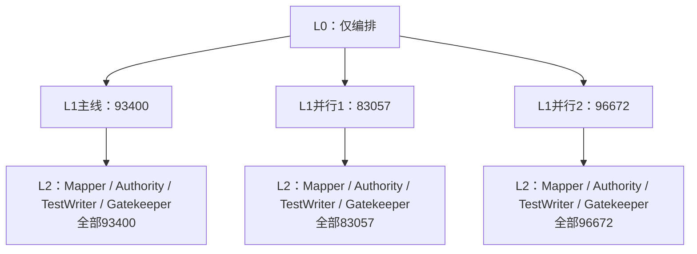

# CJMP 三模型、三级代理编排流程

版本：2026-11-19。用途：在新会话中完整实施原 CJMP 计划的前端部分。

## 1. 目标与输入

目标仅限原七十项、P0–P10及有效修订中的前端要求。保留计划内 CJO/SOURCE、默认参数、类型、诊断、LL/Analysis API 的实际前端交付和验收；排除 CHIR 后端转换、LLVM/JVM代码生成、后端内联/实例化、链接和机器码运行。

唯一实施工作树：

`C:/Users/lin17/.codex/worktrees/cjmp-framework-implementation/cangjie`

新会话先读取以下磁盘材料，不读取旧会话来恢复实现上下文，不向原执行会话发消息，不以旧会话回复、批准或释放资源作为依赖：

1. [原计划](cjmp-framework-review-and-fix-plan-20260928.md)。
2. [前端范围及验收](cjmp-frontend-subset-audit-20261117.md)和[前端逐项账](cjmp-frontend-subset-20261117.json)。
3. [滚动审计](cjmp-progress-audit-20261008.md)，优先核对最新有效记录。
4. [交接索引](cjmp-framework-handoff-20261117.md)及最新的 SOURCE、类型、decoder 接续和对应证据。
5. 工作树实际 `AGENTS.md`、适用的嵌套规则和 `D:/code/intellij/cangjie/.agents/skills/kotlin-cangjie-frontend-parity/SKILL.md`。

原始总账和历史修改全部保留。历史91.22%、单批通过率或单个 SOURCE14 通过不能代替当前前端整体验收。

## 2. 固定拓扑与模型

L0是主会话，只负责编排；它的直属子代理恰好三个。每个L1负责自己的实现，并派遣自己的L2角色。L2不再派遣下一层。

| 层级/角色 | 固定模型请求标识 | 直属上级 | 职责 |
| --- | --- | --- | --- |
| L0 编排主会话 | 新会话可选下列三个路由之一 | 用户 | 任务拆分、写入租约、依赖、并发名额、冻结验证窗口、进度汇总 |
| L1 主线 | `ccs-any-93400/gpt-6.1-sol` | L0 | P8、E6及必要C5依赖：源码/CJO类型与内容、默认实现、来源位置、正式消费 |
| L1 并行1 | `ccs-any-83057/gpt-6.1-sol` | L0 | C3/C4/D5/E8/E9：成员预检查、遮蔽、继承、约束映射、extend判重 |
| L1 并行2 | `ccs-any-96672/gpt-6.1-sol` | L0 | E7/E12/F4/G1/G3/G5：注解/checker调度、模块依赖、LL/API及文件归属 |
| L2 KotlinFrameworkMapper | 与创建它的L1完全相同 | 所属L1 | 固定Kotlin源码、框架位置与调用链映射 |
| L2 CangjieSemanticsAuthority | 与创建它的L1完全相同 | 所属L1 | 官方仓颉源码/文档/必要cjc取证及真实语义 |
| L2 CangjieTestSemanticsWriter | 与创建它的L1完全相同 | 所属L1 | 根据已确认仓颉语义准备测试数据和必要测试 |
| L2 KotlinParityGatekeeper | 与创建它的L1完全相同 | 所属L1 | 独立审查候选及完整框架/语义合同 |

三个L1模型必须各不相同；创建后不得自行改路由。L1创建L2时显式传入自己的完整模型请求标识，以保证继承关系不被运行器的全局子代理默认模型覆盖。L2不能自行选择模型。模型失败或限流不得切换到另一个路由或通用裸模型名。

每个L1执行自己的四角色流程。不是由L0创建十二个审查/考证节点，再把它们分给三个L1。



## 3. 各层权限与通信

### L0

- 只能派遣、等待、恢复、重定向或关闭自己的三个L1。
- 只能读计划、调度材料、L1汇总、验证摘要和文件变动元信息；不承担Kotlin/仓颉源码考证、测试数据编写或实现审查。
- 只能写本流程的控制账、任务卡、租约、依赖和进度记录；禁止编辑生产代码、测试、fixture、golden或生成代码。
- 编译、cjc、Gradle、API/IDE/document验收由获得验证任务的L1执行；L0不能亲自执行这些任务。
- 不取得、派遣、等待、恢复、重定向或单独关闭L2。关闭L1导致运行器自动关闭其后代属于父树清理，不是L0直接操作L2。

### L1

- 是所属实现分支的生产代码负责人，接收L0任务、申请资源，并只向L0返回分支汇总。
- 只能控制自己创建的L2；禁止接管兄弟L1的后代。
- 不能直接与兄弟L1通信。跨分支接口、文件和验证请求均提交L0转交。
- 不直接修改其他分支租约内的文件。跨分支变更交由文件负责人实施，或经L0明确转移租约。

### L2

- 只接收直属L1任务，结果只返回创建自己的L1。
- 禁止直接联系L0、其他L1、兄弟L2或其他子树；禁止派遣L3。
- 不查找祖先/兄弟会话标识，不使用跨会话消息工具绕过父节点。
- Mapper/Authority/Gatekeeper不写生产或测试；TestWriter只写直属L1分配的测试文件。
- 不能用本层审查结论关闭原条目；由L1完成实现与验证后汇总，L0只做账本核对。

上行采用直属父节点正常收集的阶段/完成结果；下行采用直属父节点的任务和管理消息。创建代理统一使用 `fork_context: false`，显式提供任务卡和必要文件，不复制祖父会话历史、代理句柄或原始长日志。

运行器自动显示的后代状态事件不作为L2向L0提交的工作报告。L0不直接采纳越级消息；仅通知其直属L1处理并重新提交正式汇总。

这是工作流的严格操作协议。现有工具参数未提供按收件人设置的父子通信ACL；不能把提示词纪律宣称为运行器强制隔离。

## 4. 新会话启动验收

按顺序执行，任何必要能力未成立时不开始生产写入：

1. 核对工作树、已有修改、适用规则和已有Gradle队列。启动时必须已结束旧执行会话对该树的并行写入；遇资源冲突如实报告，不联系旧会话、强杀进程或回退已有修改。
2. 发现实际可调用的多代理工具和模型参数，载入[静态分工表](cjmp-three-agent-manifest-20261119.json)。
3. L0分别以三个固定路由创建三个L1，初始任务只执行BOOTSTRAP，不读编译器源码、不修改生产。
4. L1检查自己的真实工具清单，并申请一个L2名额。仅由该L1创建一个 `KotlinFrameworkMapper` 的CAPABILITY_ONLY探针，模型字段显式等于其L1路由，任务只返回接收确认。
5. L1正常收集并关闭自己的探针，报告模型请求标识、二级派遣成功/真实失败、可用工具和已释放名额；L0不联系该探针。
6. 三个L1都证明二级派遣可用、固定模型请求正确后，L0才授予任务、写入租约及实现阶段许可。

BOOTSTRAP报告只有真实结果，不能以“应该继承”“参数类型是字符串”或自述模型名代替工具调用证据。

### 本次环境实测

2026-11-19已分别成功请求并收到三个L1模型路由探针的回复。主线93400探针的实际工具清单没有任何 `spawn_agent`、`spawnAgent`、`multi_agent`条目，未能创建L2。因此：

- 三个一级模型路由已在本会话验证。
- 当前环境的二级派遣未通过启动验收，未验证任何L2实际运行。
- 新会话必须重新检验L1是否获得派遣工具；不能将本文件当作当前环境已经支持三级运行的证明。
- 一级没有派遣工具时，L0报告 `CAPABILITY_BLOCKED`，保留流程和已有工作；不能由L0越级代派、令L1自行兼任Gatekeeper或使用外部CLI假装二级代理。

当前官方配置文档公开的并发项可参考如下片段；这里只提供合并到现有配置的参考，不自动修改用户配置：

```toml
[agents]
enabled = true
max_concurrent_threads_per_session = 9
```

9表示三个L1加最多六个同时存活的L2，不含L0。并发设置不等于给L1开放派遣工具；具体二级派遣开关未在当前检索中核实，不填写猜测的深度配置键。

## 5. 分工、写入租约和接口

分工表是原ID负责人划分，不是模块整体写授权。L1先提交实际目标、拟修改的绝对文件路径、只读引用、依赖接口和验收条件；L0逐文件授予租约。

每张任务卡至少包含：

L0和各L1分别使用[分层派工模板](cjmp-three-agent-templates-20261119.md)，补齐本层参数后派遣；不能只发送角色名称，令新代理从祖先会话猜测任务。

```json
{
  "task_id": "由L0分配",
  "original_ids": ["原计划ID"],
  "acceptance_requirements": ["原文要求或有效修订"],
  "owner_lane": "mainline / parallel1 / parallel2",
  "model_request": "对应固定完整路由",
  "write_files": ["已授予租约的绝对路径"],
  "read_only_roots": ["固定参考树或必要一方依赖"],
  "depends_on": ["具体产品或接口任务"],
  "required_roles": ["KotlinFrameworkMapper", "CangjieSemanticsAuthority", "CangjieTestSemanticsWriter", "KotlinParityGatekeeper"],
  "verification_targets": ["由实现负责人确定的必要目标"],
  "state": "RESEARCH"
}
```

共享 `common`、`resolution.common`、`cfir/semantics.api`、`cfir/providers`、tree generator及公共测试支撑不能按目录整块同时授予多个分支。接口变更任务包含拥有文件、调用方、行为和验收约束，由其负责人实现；依赖者只在已授予租约内接入。

一个原ID可依赖其他分支产品，但只有分工表所列负责人提交整项关闭。交叉依赖和H6前端/后端子要求由L0显式登记，不能重复计分。

七十项负责人覆盖不代表重新实现七十项。沿用有效的已完成产品，围绕当前余额、受影响回归和原阶段验收继续推进。跨阶段P0取证由并行2统筹其Authority子角色，P10集成验收由主线执行；L0只安排任务和窗口，不亲自取证或运行检查。

控制账仅由L0维护；分支报告分别放在 `docs/cjmp-orchestration-20261119/mainline/`、`parallel1/`、`parallel2/`。L2报告只能写直属L1给定的本分支路径，不能改控制账或兄弟报告。

## 6. 每个L1的完整实施周期

技能中“main thread owns production edits”在本流程映射为每个L1的本地实现负责人；用户明确要求L0只编排，L0不接管这些代码职责。

1. **RESEARCH**：申请名额后由L1并行派遣Mapper和Authority。Kotlin固定对象 `3c7a5041f238102285764d370665f56f587f9dc4`，仓颉v113固定对象 `14276740ffec1262b81b6b5236b1d840af270b37`；参考树只读，用 `git show`，不以当前checkout代替版本证据。
2. **SEMANTIC_PLAN_READY**：L1对齐两份结论，形成模块/包/文件/类/方法/helper/调用链及真实仓颉语义映射。Kotlin不存在的格式产品或仓颉语义差异必须有官方证据；不以“概念对齐”验收。
3. **FIXTURE_READY**：由该L1派遣自己的TestWriter，转交Authority结论。测试数据基于真实仓颉语法/语义；必要时使用官方cjc验证。正确源码、fixture、golden、诊断位置及原断言保留。
4. **IMPLEMENTING**：L1自己编写生产实现，先做共享框架根因，再接真实消费者。禁止最小/简化实现、兜底、回退、兼容层、扩大nullable、伪造phase、空CFG、body=0或按fixture形状补丁。接口及关键框架代码保留中文注释。
5. **REVIEW**：仅由该L1派遣自己的Gatekeeper，提供候选文件集合、SHA、固定映射、语义证据及原验收范围。Gatekeeper只写报告；审查结论绑定该候选，不移用旧ACCEPT。
6. **REVIEW_REJECTED**：L1将全部确认拒绝项转为下一修订，立即继续实现和复审。真正的新正确性问题归属原要求和消费者；无原需求或真实消费者的全语言/后端/通用R5扩展不能成为新目标。
7. **VERIFY_QUEUED**：L1提交经过完整审查的候选和验证计划，等待L0安排冻结窗口。
8. **VERIFYING**：获得验证票据的L1执行真实编译、语义回归和正式消费；其余分支遵守冻结范围。
9. **DONE_REQUIREMENT / DONE_ITEM**：L1依据完整原条件报告关闭，L0核对证据和依赖后更新账。局部测试只关闭对应子要求，不能关闭整层、整个原ID或总目标。

需要新的L2调用时先关闭已不再需要的本分支节点。完成但仍打开的代理继续占并发名额；不能把名额已释放与任务已结束混为一谈。

## 7. 并发与验证窗口

L0维护L2名额。配置容量为N时，三个L1常驻，L2最多使用N−3席；正式执行至少需要两个L2席，以支持每个分支的Mapper/Authority成对考证。默认容量未经核实时不猜数值，按实际启动结果或已确认配置执行。

推荐N=9，使三个分支可以同时运行各自两名考证角色。考证结束关闭对应L2，再进入TestWriter和Gatekeeper阶段；不让四种角色全部长期常驻。资源不足时调度完整阶段的先后，不省略角色或改模型。

所有Gradle都在同一工作树使用 `gradlew-queue.bat`。同一验证窗口只分配一个L1执行者：

1. 各分支完成需要在窗口前执行的正式生成任务。
2. L0通知所有L1停止修改验证输入集合，收到直属确认后授权冻结；各L1负责通知自己的L2。
3. 执行者采样实际输入、候选SHA和配置，再通过队列运行相应目标。L0不运行构建。
4. 执行者确认真实终态及原XML时间窗口、classname+case-key、pass/fail/error/skip与输入前后变化。未执行、缓存结果、环境失败、输入漂移分别记录。
5. L0领取直属L1报告后释放窗口。失败由文件负责人修订；不能由L0编写修复。

冻结期间可做不改输入的固定参考源码考证。禁止修改冻结范围、吞掉冲突、复用旧XML、拼接不同窗口或将原有skip算通过。

不受新修改影响且已充分通过的检查不无理由重跑；共享接口或类型规则变化时执行真正受影响的回归，不能为了速度缩减原验收。

## 8. 完成、等待和交接

每个L1的阶段汇总应简短，并包含：

- 原ID/子要求、本轮交付和实际变动文件。
- 固定模型请求、调用角色及全部L2已关闭/仍存活的数量；不向L0分发L2可操作句柄。
- 本候选审查范围、ACCEPT/REJECT和未关闭finding。
- 真实队列/输入/结果证据路径，环境问题与语义问题分开。
- 完整关闭了哪个原要求；当前依赖、剩余阻断和下一步。

L0只接收这三个直属分支的汇总，维护任务卡、文件租约、名额、冻结窗口和原ID状态。不把原始编译日志、长XML/base64和全部源码搬入主会话上下文。

L1上报L0采用简短状态摘要和证据路径，详细映射、拒绝项、原日志与完整结果保存在本分支磁盘材料。L0需要补充证据时仍向直属L1请求，不直接找L2复述。

某分支遇依赖等待时，L0转交其具体接口请求或安排不依赖该产品的原计划工作；不让整个前端目标等待一个未闭层。限流、上下文压力、构建环境失败不等同语义任务完成。

各L1在上下文压力出现前写本分支磁盘检查点，再经L0管理本分支恢复。重启保持角色、固定模型、证据和租约关系；关闭旧L1及其后代后才能替换同一直属位置，不增加第四个L1。没有用户明确要求，不建立额外用户会话。

原ID的完整条件、跨分支依赖、正常取消/失效和生产消费者均通过后才能整项关闭；P0/P10、H6前端及其它最终门未完成时不能宣布原前端目标完成。后端排除不计为通过，v10待办不阻断其他授权实施，但最终账中如实保留。

## 9. 可调用工具形状

根会话只创建三个L1，参数中的模型是实际路由：

```javascript
const lanes = [
  { id: "mainline", model: "ccs-any-93400/gpt-6.1-sol" },
  { id: "parallel1", model: "ccs-any-83057/gpt-6.1-sol" },
  { id: "parallel2", model: "ccs-any-96672/gpt-6.1-sol" },
];
// 每个initialPrompt包含BOOTSTRAP限制、分工、模型和本流程路径。
const results = await Promise.allSettled(lanes.map(lane =>
  tools.multi_agent_v1__spawn_agent({
    model: lane.model,
    fork_context: false,
    message: initialPrompts[lane.id],
  })
));
// 核对每个结果；失败保持原模型，不补建第四角色或改为单模型。
```

L1创建L2的调用由L1自己发起：

```javascript
const child = await tools.multi_agent_v1__spawn_agent({
  model: assignedLaneModel,
  fork_context: false,
  message: rolePrompt,
});
// assignedLaneModel必须等于当前L1固定路由。
// 只操作本L1创建的child.agent_id，结果只返回本L1。
```

这些示例对应本会话已发现的工具参数，不假设有未公开的agent_type、父节点ACL或深度覆盖参数。

## 10. 官方文档与本地约束

- [Subagents：模型继承与编排](https://learn.chatgpt.com/docs/agent-configuration/subagents.md)。
- [Codex配置参考](https://developers.openai.com/codex/config-reference)。
- Kotlin/仓颉前端parity技能：`D:/code/intellij/cangjie/.agents/skills/kotlin-cangjie-frontend-parity/SKILL.md`。

所有一方文件使用 `apply_patch`，PowerShell使用7，`Get-Content`显式UTF-8；主仓库和external只读。配置示例不修改现有全局设置，也不代表已完成当前运行器的二级能力配置。
